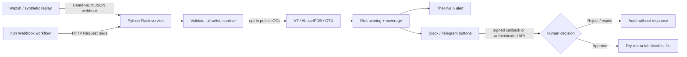
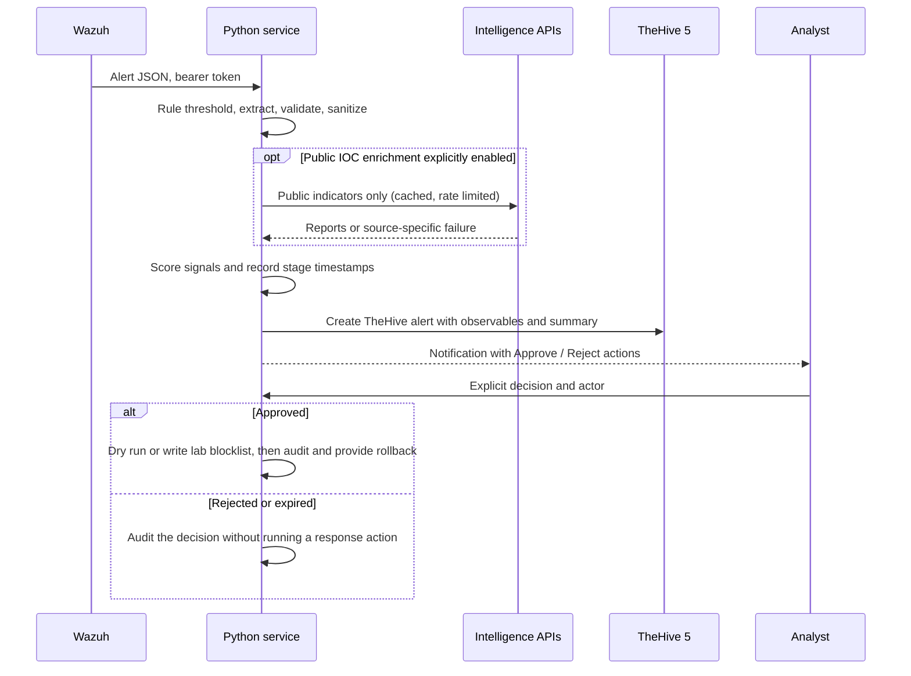

# SOC Incident Response Automation

Portfolio lab for a human-approved Wazuh alert workflow. It extracts public indicators, optionally enriches them through threat-intelligence APIs, calculates a documented score, creates a TheHive 5 alert, sends a Slack or Telegram summary, and waits for an explicit analyst decision before a lab-only action.

> **Lab use only.** Use synthetic/anonymized alerts. Real enrichment is off by default. The response action only writes to a local text blocklist, starts in dry-run mode, and never changes a host firewall.

## Problem

Manual triage repeats IOC extraction, reputation lookups, case creation, and notification. This project makes those steps reproducible and measures elapsed time without fabricating results. The human remains responsible for response decisions.

## Architecture



### Sequence



## Quick start

Requirements: Docker Engine and Docker Compose v2. Copy the environment template and start the demo stack:

```powershell
Copy-Item .env.example .env
docker compose up --build -d
```

This starts the Python service, n8n, TheHive 5.6.3, Cassandra 4, and Elasticsearch 7.17.9. TheHive database dependencies can take a few minutes on first boot. Open [n8n](http://localhost:5678) and [TheHive](http://localhost:9000); the API is on [localhost:8080](http://localhost:8080/health). TheHive has its built-in free license and organization limit. Complete its first-run setup and create a least-privilege API key before configuring the service.

To replay at least 30 synthetic alerts against the Python service:

```powershell
docker compose --profile demo run --rm mock-alert-generator
```

The generator saves `benchmarks/latest-run.json` on the host. For another run after installing the package: `python scripts/replay_demo.py --count 30 --output benchmarks/latest-run.json`.

To install Python tools and run unit tests:

```powershell
py -3.11 -m venv .venv
.\.venv\Scripts\Activate.ps1
python -m pip install -e ".[dev]"
ruff check .
pytest
```

To stop the lab: `docker compose down`. To also remove stored service data: `docker compose down -v`.

## Configuration

Copy `.env.example` to `.env` and replace demo secrets. Never commit `.env`. Keep `ENRICH_PUBLIC_IOCS=false` until you have reviewed the data-sharing implications and configured allowlists; set the three API keys individually. The Python API uses `AUTOMATION_API_TOKEN` for Wazuh and n8n requests. The n8n workflow export is in `n8n/`; import it, create a Header Auth credential named **SOC Automation API Token** with header `Authorization` and value `Bearer <AUTOMATION_API_TOKEN>`, and set the n8n environment variable `SOC_AUTOMATION_URL=http://python-service:8080`. Configure the Wazuh Webhook URL as `http://<lab-host>:5678/webhook/wazuh-alert` for n8n or `http://<lab-host>:8080/webhook/wazuh` for the direct Python path.

The direct approval API is `POST /approval/<alert_id>` with `{"decision":"approve|reject","actor":"analyst-id"}` and the bearer token. Slack interactive requests must target `/approval/slack` and pass Slack signature verification. Telegram callbacks must target `/approval/telegram` with the configured webhook secret. Notifications are optional. For Telegram, register the callback URL with Telegram's webhook settings; the project does not register it automatically. For direct Wazuh delivery, install `scripts/wazuh-integration.py` at `/var/ossec/integrations/custom-soc-automation` and use `config/wazuh-integration.xml.example`; it follows Wazuh's alert-file and argument contract. If Wazuh should post through n8n, set the Wazuh `hook_url` to `http://<n8n-host>:5678/webhook/wazuh-alert` and configure the n8n webhook credential with `Authorization: Bearer <AUTOMATION_API_TOKEN>`.

## Scoring

The per-IOC score is the weighted mean of available source signals, with unavailable sources omitted and the remaining weights renormalized:

| Source | Weight | Signal normalized to 0–100 |
| --- | ---: | --- |
| VirusTotal | 50% | malicious detections / all returned analysis verdict counts |
| AbuseIPDB | 30% | `abuseConfidenceScore` (IP only) |
| AlienVault OTX | 20% | `min(100, 25 × pulse_count)` |

The alert score is the highest scored IOC, so benign indicators do not dilute one high-risk observable. The response includes the number of scored/unscored IOCs and source coverage. Errors, timeouts, rate limits, and missing credentials are not treated as clean verdicts. If no source gives a usable signal, the score is `null`/unscored. Severity mapping is 1 below 40, 2 from 40, 3 from 70, 4 from 90; unscored alerts use low severity and require triage. This score is a prioritization aid, not a probability or an automatic decision.

## Approval and response boundary

An alert creates a pending approval record with a 24-hour expiry. Only an explicit authenticated API decision, valid Slack signature, or Telegram webhook secret can decide it. Reject, expiry, or missing approval runs no action. Approval targets public IP observables only. Default `DRY_RUN=true` reports what would happen. With dry-run disabled, the sole action adds the selected address to `LAB_BLOCKLIST_PATH`; it never invokes a shell or edits firewall configuration. Use `python scripts/rollback-lab-block.py <public-ip>` to remove it. Each decision/action is appended to JSONL audit.

## Benchmark results

No benchmark has been run in this repository yet. Do not report the example fixture count as a measured operational result. Run the replay and fill manual timings from your own 5–10-alert exercise using [the baseline template](benchmarks/manual-baseline-template.csv). The automated JSON records per-alert elapsed time, stage timestamps, error count, average, median, and p95. The script never manufactures a manual baseline. API failure and timeout counts appear in each response and the JSONL audit log.

| Measure | Manual baseline | Automated replay |
| --- | ---: | ---: |
| Alerts measured | **TODO: enter your observed N** | **TODO: run benchmark** |
| Average seconds / alert | **TODO: measured** | **TODO: run benchmark** |
| Median seconds / alert | **TODO: measured** | **TODO: run benchmark** |
| Time saved / alert | **TODO: compute from measured values** | **TODO: compute from measured values** |
| API failures / timeouts | n/a | **TODO: run with selected API keys** |
| False-positive labels | **TODO: label 5–10 alerts** | **TODO: inspect and label benchmark alerts** |

## Demo GIF

`[TODO: add a short screen recording of synthetic alert -> TheHive -> analyst approval]`

## Tests and verification status

Unit tests mock all external APIs. The Docker Compose smoke test is opt-in with `RUN_COMPOSE_INTEGRATION=1`. The real TheHive API, n8n import/execution, Wazuh delivery, and Slack/Telegram button callbacks have **not been tested against a live lab installation** in this workspace. Check `docs/runbook.md` for the verification checklist.

## MITRE ATT&CK scenarios

The synthetic scenarios in this portfolio map to credential access via brute-force behavior (T1110), command and control via suspicious external communications (T1071), and execution/file-based malware detection (T1204.002 as a broad user-execution scenario). These are illustrative scenario labels; fixtures do not prove these techniques occurred. See [the mapping](docs/mitre-mapping.md).

## Known limitations

- The n8n export is an orchestration adapter to the Python canonical pipeline, not a separate implementation of scoring and vendor integrations.
- The approval registry is in process memory; restart loses pending decisions. Use a durable store before a multi-worker deployment.
- The local rate limiter is per process. Use a shared limiter if you run multiple service replicas.
- Public suffix checks and an indicator allowlist cannot infer every organization's internal DNS namespace. Add all internal domains/hostnames to the allowlist and do not enable enrichment until reviewed.
- OTX pulse count is community context, not a calibrated maliciousness probability. The score is a portfolio heuristic.
- TheHive deployment uses an official test-stack shape and built-in free license defaults; it is a lab, not production guidance. Cortex is not included.

## Security

API keys are read only from environment variables and excluded from Git. Use least-privilege API keys, keep ports private, rotate demo secrets, and do not use real internal alerts. VirusTotal says queried indicators can enter its shared dataset; do not query sensitive indicators. Private/reserved IPs are rejected, URL hosts are validated, and allowlist domain entries also exclude their subdomains (for example, `*.corp.example.com`) through `config/allowlist.example.txt`. Add organization-specific internal domains and hostnames there before enabling enrichment. Alert content is untrusted: it is never executed, passed to a shell, or used as policy. The response action is fixed in code and restricted to a local file. See [SECURITY.md](SECURITY.md) and [the automation threat model](docs/threat-model.md).

## License

MIT. See [LICENSE](LICENSE).
