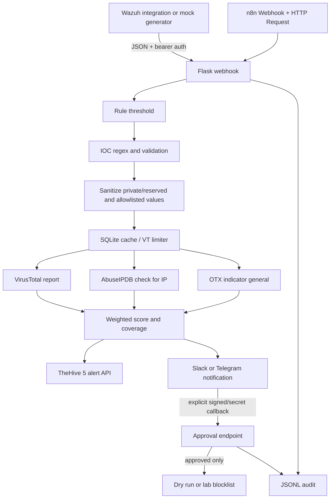

# Architecture

Python implements the canonical business logic. n8n is an alternate intake/orchestration adapter to the same service. API endpoint references are current official documentation at implementation time: [VirusTotal IP report](https://docs.virustotal.com/reference/ip-info), [VirusTotal API overview/rate limit](https://docs.virustotal.com/docs/api-overview), [AbuseIPDB v2](https://docs.abuseipdb.com/), [OTX API](https://otx.alienvault.com/api/), [TheHive API](https://docs.strangebee.com/thehive/api-docs), [n8n HTTP Request node](https://docs.n8n.io/integrations/builtin/core-nodes/n8n-nodes-base.httprequest/). The Docker lab follows the official [TheHive 5 test stack shape](https://github.com/StrangeBeeCorp/TheHiveMCP/blob/main/docker-compose.test.yml), using TheHive 5, Cassandra 4 and Elasticsearch 7.17.
